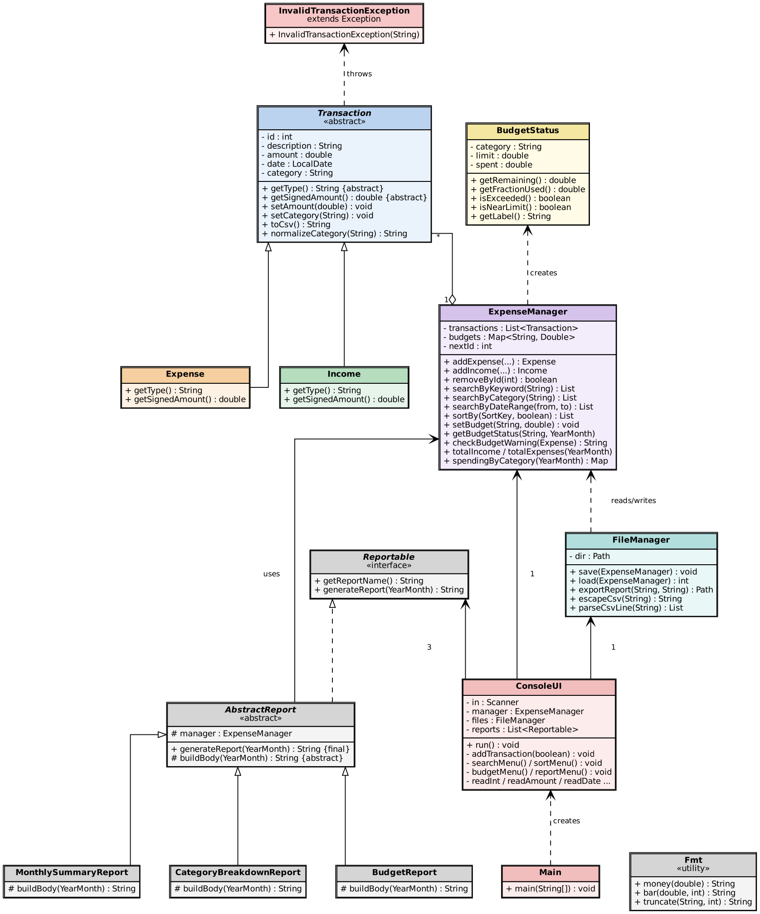
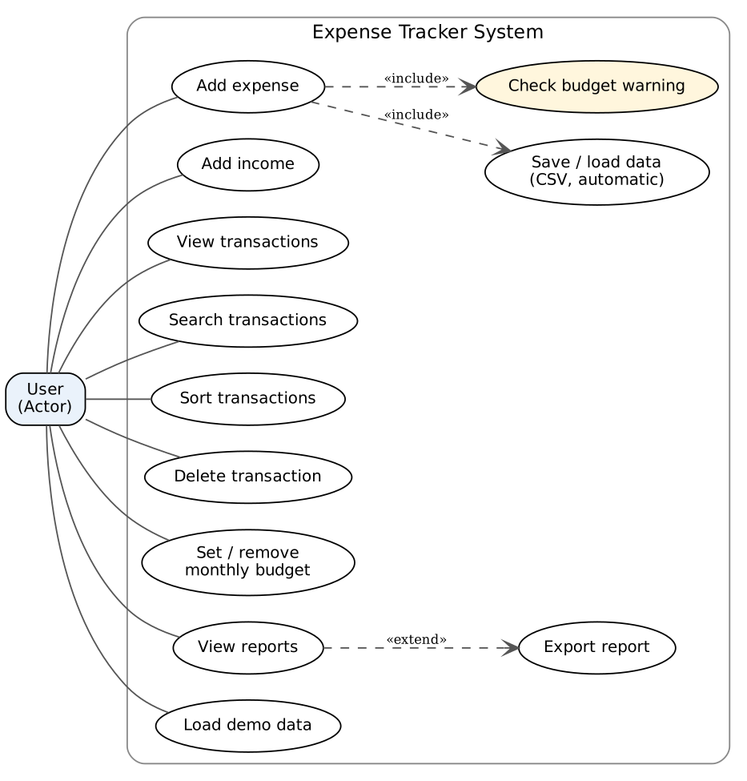

# Expense Tracker

**Mini Java Project – Topic #13: Expense Tracker**

A console-based personal finance application written in Java

**Group members**
- Badilla, Reynald Rey (Project Leader)
- Gumarang, Christian
- Odover, Sarah Jane

**Date:** November 2026

---

## 1. Project Description and Objectives

The Expense Tracker is a menu-driven console application that helps a user record
their daily income and expenses, set monthly spending limits per category, and
understand where their money goes through searchable lists and printed reports.
All amounts are shown in Philippine pesos (PHP). Every change is saved
automatically to CSV files, so the data is still there the next time the program
starts.

The project was built to practise object-oriented programming in Java on a
realistic, everyday problem. Our objectives were to:

1. Model the problem with well-separated classes that each have one clear responsibility.
2. Apply the four OOP principles: inheritance, polymorphism, encapsulation and abstraction.
3. Use Java Collections (`ArrayList`, `HashMap`, `TreeMap`) to store and summarise data.
4. Handle invalid input safely with exceptions, including our own custom exception, so the program never crashes on bad input.
5. Save and load data using files so information persists between runs.
6. Provide useful search, sort and reporting features.
7. Verify the logic with automated JUnit 5 tests and manage the code with Git/GitHub.

## 2. Features

**Recording transactions.** The user can add an expense or an income. Each
transaction has a description (up to 60 characters), an amount (greater than zero,
rounded to two decimals), a date (`yyyy-MM-dd`, or press Enter for today) and a
category. Every transaction gets a unique ID number.

**Categories.** A quick-pick list is offered: *Food, Transport, Bills, Shopping,
Health, Entertainment, Education, Other* for expenses, and *Salary, Allowance,
Business, Gift, Other* for income. The user may also type their own category (up
to 20 characters). Category names are normalised, so "food", "FOOD" and " Food "
are all stored as "Food".

**Monthly budgets with warnings.** The user can set, update or remove a monthly
spending limit for any expense category. Right after an expense is added, the
program checks that category's budget for the expense's month:
- at **80% or more** of the limit it prints a "Heads up" message showing the percentage used and the amount left;
- **above 100%** it prints a "WARNING" showing how much the budget was exceeded by.

Budget status is labelled **OK**, **NEAR LIMIT** or **OVER BUDGET**.

**Viewing and deleting.** All transactions can be listed newest first in a table
that also shows the net total. A transaction can be deleted by ID after a
confirmation prompt. The main menu always shows the overall balance and the
current month's income and expenses.

**Search.** Transactions can be searched by keyword (matches description or
category, case-insensitive), by category, by date range (if the dates are entered
in the wrong order, they are swapped automatically) or by ID.

**Sort.** Transactions can be sorted by date, amount or category, in ascending or
descending order. Ties are broken by ID so the order is always predictable.

**Reports.** Three reports are available for any month:
1. **Monthly Summary** – total income, total expenses, net saved or deficit, savings rate, number of transactions, the largest expense and a list of that month's transactions.
2. **Spending by Category** – amount and percentage share per category, highest first, with a text bar chart.
3. **Budget Status** – budget, spent and remaining amounts per category with a progress bar and status label.

**Report export.** After viewing a report, the user can save it as a text file in
`data/reports/`, for example `monthly_summary_2026-11.txt`.

**CSV persistence.** Transactions are stored in `data/transactions.csv` and budgets
in `data/budgets.csv`. Data is loaded automatically at start-up and saved after
every change and on exit. Descriptions containing commas or quotes are escaped
correctly. Damaged lines in the files are skipped and reported instead of stopping
the program. A different data folder can be passed as a command-line argument.

**Demo data.** Menu option 9 loads 20 sample transactions (3 incomes and 17
expenses dated relative to today) and 5 budgets, which is useful for
demonstrations.

**Robust input.** Every prompt re-asks until valid input is given (numbers within
range, valid dates and months, yes/no answers). If the input stream is closed, the
program still saves before exiting.

## 3. Class Design

The program consists of 15 source files in the package `expensetracker`: 14 classes
and 1 interface, plus the nested enum `ExpenseManager.SortKey`.

*Figure 1 – UML class diagram (docs/UML_Class_Diagram.png)*

*Figure 2 – UML use case diagram (docs/UML_UseCase_Diagram.png)*

### 3.1 Transaction model

- **`Transaction` (abstract class)** – the base class for every money movement. It holds
  the `id`, `description`, `amount`, `date` and `category` as **private** fields.
  Values can only be changed through validated, `final` setters that throw
  `InvalidTransactionException` when data is invalid (empty text, amount ≤ 0 or
  above the maximum, missing date, text too long). The static method
  `normalizeCategory()` gives categories a consistent spelling. It declares two
  abstract methods, `getType()` and `getSignedAmount()`, and provides `toCsv()` and
  `toString()`, which call `getType()`.
- **`Expense`** and **`Income`** – subclasses of `Transaction`. `Expense.getSignedAmount()`
  returns a negative value and `Income.getSignedAmount()` a positive value;
  `getType()` returns `"EXPENSE"` or `"INCOME"`.
- **`InvalidTransactionException`** – a custom checked exception (extends `Exception`)
  used for all invalid transaction, category and budget data.

### 3.2 Business logic

- **`ExpenseManager`** – the core of the program. It stores transactions in an
  `ArrayList<Transaction>` and budgets in a `HashMap<String, Double>`, and
  assigns IDs. It provides add/remove (`addExpense`, `addIncome`, `removeById`,
  `findById`, `restore`), searches (`searchByKeyword`, `searchByCategory`,
  `searchByDateRange`), sorting (`sortBy(SortKey, ascending)` using `Comparator`),
  budget handling (`setBudget`, `removeBudget`, `getBudgetStatus`,
  `checkBudgetWarning`) and summaries (`transactionsInMonth`, `totalIncome`,
  `totalExpenses`, `getBalance`, `spendingByCategory`, which uses a `TreeMap` so
  categories come out in alphabetical order).
- **`BudgetStatus`** – an immutable snapshot of one category's budget for one month
  (limit, spent, remaining, fraction used). It decides whether the budget is near
  the limit (≥ 80%) or exceeded and returns the matching label.

### 3.3 Persistence

- **`FileManager`** – saves and loads both CSV files with `BufferedWriter` /
  `BufferedReader` in UTF-8, using try-with-resources so files are always closed.
  It contains a small CSV parser (`parseCsvLine`) and escaper (`escapeCsv`) that
  handle commas and quotes, rebuilds the correct subclass (`Expense` or `Income`)
  from the `type` column, counts skipped bad lines (`getLastSkipped`) and writes
  exported reports with `exportReport`.

### 3.4 Reports

- **`Reportable` (interface)** – the contract for every report: `getReportName()` and
  `generateReport(YearMonth)`.
- **`AbstractReport` (abstract class)** – implements `Reportable` using the *Template
  Method* pattern. Its `final generateReport()` prints the common header (title and
  period) and footer, and calls the abstract `buildBody()` that each subclass
  provides.
- **`MonthlySummaryReport`**, **`CategoryBreakdownReport`**, **`BudgetReport`** – the three
  concrete reports, each overriding `getReportName()` and `buildBody()`.
- **`Fmt`** – a utility class (private constructor, static methods) for consistent
  formatting: money with the PHP currency, signed amounts, text progress bars,
  separator lines and text truncation.

### 3.5 User interface

- **`ConsoleUI`** – shows the menus, reads and validates all input with `Scanner`,
  calls `ExpenseManager`, `FileManager` and the reports, and catches exceptions to
  show friendly messages. It keeps the reports in a `List<Reportable>`.
- **`Main`** – the entry point. It reads an optional data folder argument (default
  `data`) and starts `ConsoleUI`.

### 3.6 How the OOP concepts are applied

| Concept | How it appears in the code |
|---|---|
| **Inheritance** | `Expense` and `Income` extend `Transaction`; the three reports extend `AbstractReport`; `InvalidTransactionException` extends `Exception`. |
| **Polymorphism** | `getBalance()` adds up `t.getSignedAmount()` for every `Transaction` without checking its type. `ConsoleUI` stores reports as `List<Reportable>` and calls `generateReport()` on whichever report was chosen. `toCsv()` calls the overridden `getType()`. |
| **Encapsulation** | Private fields with validated setters in `Transaction`; `getAll()` returns an unmodifiable list; `getBudgets()` and `sortBy()` return copies so outside code cannot change internal data; `BudgetStatus` is immutable. |
| **Abstraction** | Abstract classes `Transaction` and `AbstractReport`, and the `Reportable` interface. `ConsoleUI` only depends on what these types promise, not on their details. |
| **Collections** | `ArrayList` for transactions and search results, `HashMap` for budgets, `TreeMap` for sorted category totals and budget lists, `List.sort` with `Comparator`, `Collections.unmodifiableList`. |
| **Custom exceptions** | `InvalidTransactionException` is thrown by validation and caught in `ConsoleUI` (message shown to the user) and in `FileManager` (bad line skipped). `IOException` is also handled when reading, saving and exporting. |
| **File persistence** | `FileManager.save()` / `load()` with CSV files, and `exportReport()` for text reports. |

## 4. Requirements Checklist

| # | Minimum requirement | Where it is met |
|---|---|---|
| 1 | At least 5 classes with clear responsibilities | 14 classes + 1 interface (Section 3), e.g. `Transaction`, `ExpenseManager`, `FileManager`, `ConsoleUI`, `AbstractReport` |
| 2 | Inheritance and polymorphism, with an abstract class or interface | `Transaction` → `Expense` / `Income`; `Reportable` → `AbstractReport` → 3 reports; polymorphic `getSignedAmount()` in `ExpenseManager.getBalance()` and `generateReport()` in `ConsoleUI.reportMenu()` |
| 3 | Encapsulation | Private fields and validated setters in `Transaction`; `ExpenseManager.getAll()` (unmodifiable) and `getBudgets()` (copy); immutable `BudgetStatus` |
| 4 | Use of Collections | `ArrayList` and `HashMap` in `ExpenseManager`; `TreeMap` in `spendingByCategory()` and `getBudgets()`; `Comparator` in `sortBy()` |
| 5 | Exception handling with a custom exception | `InvalidTransactionException`; try/catch in `ConsoleUI.addTransaction()`, `budgetMenu()`, `reportMenu()`, `loadData()`, `saveData()`; skip-bad-line handling in `FileManager.load()` |
| 6 | File persistence | `FileManager.save()`, `FileManager.load()`, `FileManager.exportReport()` (`data/transactions.csv`, `data/budgets.csv`, `data/reports/`) |
| 7 | Search and sort / report features | `ExpenseManager.searchByKeyword()`, `searchByCategory()`, `searchByDateRange()`, `findById()`, `sortBy()`; `MonthlySummaryReport`, `CategoryBreakdownReport`, `BudgetReport` |
| 8 | Version control (Git/GitHub) | Shared GitHub repository with commits from all members; workflow in `docs/GIT_GUIDE.md` |
| Bonus | Unit testing with JUnit | 34 JUnit 5 tests in `test/expensetracker/ExpenseTrackerTest.java`, run with `test.bat` |

## 5. How to Run (Windows)

**Requirements:** JDK 11 or newer. Check with `java -version` and `javac -version`.

Open Command Prompt or PowerShell in the project folder and run:

| Step | Command Prompt | PowerShell | What it does |
|---|---|---|---|
| Build | `build.bat` | `.\build.bat` | Compiles `src` into the `out` folder |
| Run | `run.bat` | `.\run.bat` | Starts the program (builds first if `out` does not exist) |
| Test | `test.bat` | `.\test.bat` | Builds, compiles the tests and runs all JUnit 5 tests |

To use a different data folder: `run.bat my-data`.

Building and running the app does not need JUnit. Only `test.bat` uses
`lib/junit-platform-console-standalone-1.10.2.jar`, which is included in the
project. On Linux/macOS, the equivalent scripts are `build.sh`, `run.sh` and `test.sh`.

**Quick demo:** start the program, choose **9** to load demo data, then try **3**
(view all), **4** (search), **5** (sort), **6** (budgets) and **7** (reports), and
finally **0** to save and exit.

## 6. Testing Summary

The automated tests are in `test/expensetracker/ExpenseTrackerTest.java` and use
**JUnit 5 (Jupiter)**. There are **34 tests**, grouped with `@Nested` classes:

| Group | Tests | What is checked |
|---|---|---|
| Validation | 6 | Zero/negative amount, empty description, empty category and missing date all throw `InvalidTransactionException` (`assertThrows`); failed adds store nothing |
| Polymorphism and totals | 6 | Category normalisation, rounding to 2 decimals, negative signed amount for expenses, balance, monthly income and expense totals |
| Search and sort | 8 | Keyword, category and date-range search; sort by amount, date and category; delete by ID and unknown ID |
| Budgets | 5 | Near-limit warning at 85%, over-budget warning, `OVER BUDGET` status, no warning without a budget, invalid budget rejected |
| File persistence | 5 | Save and reload count, descriptions with commas and quotes, budgets, ID numbering after reload, corrupt line skipped. Uses `@TempDir` so real data is never touched |
| Reports | 4 | Each of the 3 reports generates a full report for the month; an empty month is handled |

Result of the latest run of `test.bat`: **34 tests found, 34 successful, 0 failed.**

The tests cover the logic, persistence and report classes. The interactive
`ConsoleUI` is not covered by automated tests; it should be checked manually by
running the program and going through each menu option, including invalid input.

## 7. Limitations and Future Improvements

**Current limitations**
- Console interface only; there is no graphical interface.
- Single user and a single currency (PHP, set in `Fmt.CURRENCY`).
- Transactions cannot be edited in place; the user has to delete and re-add them.
- Budgets are per category per month only; unused amounts do not roll over, and there is no overall monthly budget.
- No recurring transactions (e.g. monthly bills have to be entered each time).
- Data is stored in plain-text CSV files with no password or encryption, and is meant for one program instance at a time.
- Keyword search only looks at the description and category, not at amounts.

**Possible future improvements**
- A graphical interface (e.g. JavaFX or Swing) with pie and bar charts.
- An "edit transaction" option and an undo for deletions.
- Recurring transactions and reminders for upcoming bills.
- Overall monthly budgets and savings goals.
- Exporting reports to PDF or spreadsheet formats.
- Storing data in a database such as SQLite, with user accounts and passwords.
- Support for multiple currencies.
